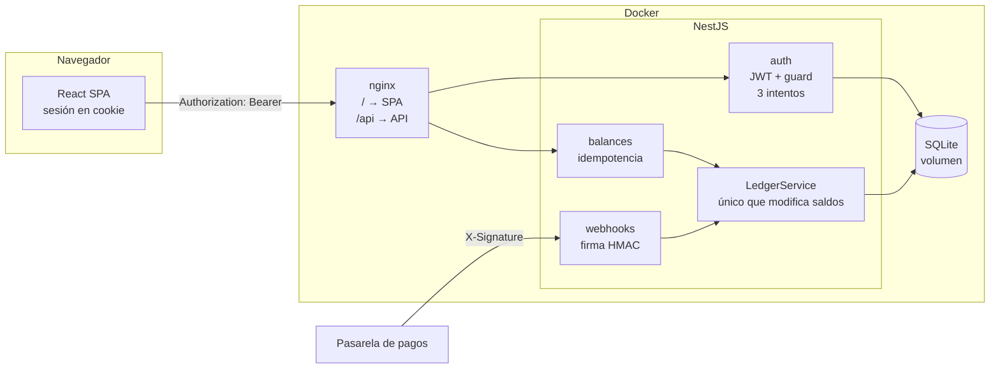

# Orbita · Servicio de saldo

Versión simplificada del servicio de saldo prepago en USD de **Orbita**: una API en **NestJS** y una pantalla web en **React + Vite**, en un mismo repositorio.

```
backend/    API NestJS + SQLite (Drizzle ORM)
frontend/   React + Vite (servido por nginx en Docker)
docs/       Plan de trabajo y arquitectura (docs/ARQUITECTURA.md)
```

## Cómo correr el proyecto

### Opción A: Docker (recomendada)

Requisitos: Docker con Compose.

```bash
docker compose up --build -d
```

| Servicio | URL |
|---|---|
| Pantalla web | http://localhost:8080 |
| API | http://localhost:3000 |
| Swagger (documentación interactiva) | http://localhost:3000/docs |

La base de datos SQLite vive en el volumen `orbita-data` y persiste entre reinicios. Para detener: `docker compose down`. Si además quieres borrar los datos: `docker compose down -v`.

Si los puertos están ocupados: `FRONTEND_PORT=8081 BACKEND_PORT=3001 docker compose up --build -d`.

### Opción B: local

Requisitos: Node.js 24 y npm 11.

```bash
npm install
cp .env.example .env   # opcional: sin él se usan valores de desarrollo
npm run dev            # API en :3000 y web en http://localhost:5173
```

En desarrollo, Vite redirige `/api/*` a la API. En Docker lo hace nginx. Así el front siempre llama a `/api` en su mismo origen, sin CORS y sin URLs embebidas en el build.

Las migraciones y los usuarios de prueba se aplican solos al arrancar la API.

### Variables de entorno

| Variable | Por defecto (dev) | Descripción |
|---|---|---|
| `JWT_SECRET` | `dev-jwt-secret` | Secreto para firmar los tokens. **Obligatoria en producción** |
| `JWT_TTL_SECONDS` | `900` | Vida del token (15 min) |
| `WEBHOOK_SECRET` | `dev-webhook-secret` | Secreto compartido con la pasarela para el HMAC. **Obligatoria en producción** |
| `DB_PATH` | `./data/orbita.sqlite` | Archivo SQLite (`:memory:` en las pruebas) |
| `PORT` | `3000` | Puerto de la API |
| `LOGIN_MAX_ATTEMPTS` | `3` | Intentos fallidos de login antes de bloquear el email |
| `LOGIN_LOCK_SECONDS` | `300` | Duración del bloqueo (5 min) |
| `LOG_LEVEL` | `debug` (dev) / `info` (prod) | `trace`, `debug`, `info`, `warn`, `error` o `silent` |

## Usuarios de prueba

| id | Email | Contraseña |
|---|---|---|
| `u_123` | `ana@orbita.test` | `Orbita123!` |
| `u_456` | `luis@orbita.test` | `Orbita456!` |

Las contraseñas se guardan con bcrypt. El seed es idempotente: solo inserta los usuarios que faltan.

## Pruebas

```bash
npm test            # unitarias de API y pruebas de la pantalla (Vitest + Testing Library)
npm run test:e2e    # e2e de la API (supertest, SQLite en memoria)
npm run lint
```

**API (e2e).** Cubren lo que más riesgo tiene:
- **Login:** el mismo error para email inexistente y para contraseña incorrecta; 401 sin token, con token inválido y con token vencido.
- **Límite de intentos:** bloqueo al 3.er fallo, aunque después llegue la contraseña correcta; un login exitoso reinicia el contador; aplica también a emails inexistentes.
- **Usuario:** el usuario sale del token y se rechaza un `user_id` en el body.
- **Idempotencia:**
  - el reintento devuelve la misma respuesta;
  - 5 solicitudes simultáneas con la misma llave acreditan una sola vez;
  - la misma llave con otro monto responde 409;
  - las llaves son por usuario.
- **Saldo:** nunca queda negativo, ni siquiera con 5 retiros simultáneos.
- **Montos:** validación de 0, negativos, 3 decimales, más de 10,000 y moneda distinta de USD.
- **Historial:** orden del más reciente al más antiguo y paginación.
- **Webhook:**
  - acredita los eventos aprobados;
  - un evento repetido no acredita dos veces;
  - un evento rechazado no acredita;
  - una firma inválida o un body alterado responden 401.

**Pantalla:**
- **Login:** mensaje entendible si las credenciales son inválidas (con los intentos restantes y el aviso de bloqueo), y validación del email antes de enviar.
- **Sesión:** se guarda en cookie y el header `Authorization` se envía; la sesión se conserva al recargar y se puede cerrar.
- **401:** si la API responde 401 se vuelve al login con el motivo; también si el token guardado ya venció.
- **Formulario:** el monto se valida antes de enviarlo; un popup pide confirmar el monto (cancelar con el botón o con Escape no envía nada); el botón se deshabilita mientras se envía y se envía la `Idempotency-Key`; además muestra el error de saldo insuficiente.

## API

| # | Endpoint | Auth | Descripción |
|---|---|---|---|
| 01 | `POST /auth/login` | — | Devuelve `{ accessToken, tokenType, expiresIn, expiresAt, user }` |
| 02 | `GET /balances/me` | Bearer | Saldo actual (se crea en 0 si no existe) |
| 03 | `POST /balances/me/deposits` | Bearer + `Idempotency-Key` | Acredita un depósito |
| 04 | `POST /balances/me/withdrawals` | Bearer + `Idempotency-Key` | Retira; el saldo nunca queda negativo |
| 05 | `GET /balances/me/transactions?page=1&limit=10` | Bearer | Movimientos del más reciente al más antiguo |
| 06 | `POST /webhooks/payment-gateway` | `X-Signature` | Evento de la pasarela (idempotente por `event_id`) |

Todos los errores tienen el mismo formato y el código HTTP adecuado:

```json
{ "statusCode": 422, "code": "INSUFFICIENT_FUNDS", "message": "Saldo insuficiente para el retiro", "details": { "available": "20.00" } }
```

| HTTP | `code` |
|---|---|
| 400 | `VALIDATION_ERROR`, `IDEMPOTENCY_KEY_REQUIRED`, `IDEMPOTENCY_KEY_INVALID` |
| 401 | `INVALID_CREDENTIALS`, `MISSING_TOKEN`, `INVALID_TOKEN`, `TOKEN_EXPIRED`, `INVALID_SIGNATURE` |
| 409 | `IDEMPOTENCY_KEY_REUSED` |
| 422 | `INSUFFICIENT_FUNDS` |
| 429 | `TOO_MANY_LOGIN_ATTEMPTS` (con `details.retryAfterSeconds`) |

### Límite de intentos de login

Se cuentan los intentos fallidos **por email** (sin distinguir mayúsculas):
- El 1.º y el 2.º fallo responden `401 INVALID_CREDENTIALS` con `details.remainingAttempts`.
- El **3.er fallo bloquea el email 5 minutos** (`429 TOO_MANY_LOGIN_ATTEMPTS`). Mientras dura el bloqueo se rechaza incluso la contraseña correcta.
- Un login exitoso reinicia el contador.
- Aplica igual a emails inexistentes, para no revelar cuáles están registrados.

La pantalla muestra "Te quedan N intentos" y, si hay bloqueo, cuántos minutos esperar.

### Logs

Logs estructurados con `nestjs-pino`:
- **Formato:** JSON en producción y una línea legible en desarrollo.
- **Request id:** cada petición recibe un `X-Request-Id` (o reutiliza el que llegue), que aparece en todos sus logs y en la respuesta.
- **Eventos de negocio que se registran:**
  - login: exitoso, fallido y bloqueado;
  - operaciones: aplicada, repetida por idempotencia y rechazada;
  - webhook: procesado, repetido y con firma inválida.
- **Nunca se escriben** tokens, firmas, cookies ni contraseñas.

```bash
docker compose logs -f backend
```

```json
{"level":30,"req":{"id":"7b45…","method":"POST","url":"/balances/me/deposits"},"context":"BalancesService","userId":"u_123","operation":"DEPOSIT","amount":"10.00","idempotencyKey":"k-1","replayed":false,"transactionId":1,"msg":"Operación aplicada"}
```

### Probar el webhook

El script firma el body con HMAC-SHA256 y lo envía, igual que lo haría la pasarela:

```bash
npm run webhook -w backend -- evt_8f2a u_123 200.00 approved
# Ejecútalo dos veces: la segunda responde duplicate: true y no vuelve a acreditar.
```

O a mano con curl:

```bash
BODY='{"event_id":"evt_8f2a","user_id":"u_123","amount":"200.00","currency":"USD","status":"approved"}'
SIG=$(printf '%s' "$BODY" | openssl dgst -sha256 -hmac dev-webhook-secret -hex | awk '{print $2}')
curl -X POST localhost:3000/webhooks/payment-gateway \
  -H 'Content-Type: application/json' -H "X-Signature: $SIG" -d "$BODY"
```

## Arquitectura

El detalle completo, con los módulos del backend, los flujos de idempotencia, webhook y sesión, el modelo de datos y las garantías, está en **[docs/ARQUITECTURA.md](docs/ARQUITECTURA.md)**.



### Modelo de datos

| Tabla | Propósito |
|---|---|
| `users` | Identidad: id, email único, hash bcrypt |
| `balances` | Saldo actual en centavos. `CHECK (amount_cents >= 0)` |
| `transactions` | **Ledger append-only**: tipo, monto, saldo resultante y origen (`idempotency_key` o `webhook_event_id` único) |
| `idempotency_keys` | Respuesta entregada por cada `(user_id, key)`, con el hash del body |
| `webhook_events` | Auditoría de cada evento: payload original, resultado (`CREDITED`, `REJECTED`, `USER_NOT_FOUND`) y número de entregas |

## Decisiones

- **SQLite (better-sqlite3 + Drizzle).**
  - Es un solo archivo, no necesita servidor y se puede inspeccionar con cualquier visor: el proyecto corre con `npm install` o con un solo `docker compose up`.
  - Sus transacciones son síncronas y toman el lock de escritura al inicio (`BEGIN IMMEDIATE`), así que dos operaciones sobre el mismo saldo nunca se intercalan. Eso evita condiciones de carrera sin locks manuales.
  - Lo que limita es la escritura concurrente desde varias instancias. Si hiciera falta escalar, Drizzle permite migrar a PostgreSQL con el mismo modelo.
- **Ledger + snapshot de saldo.**
  - Cada movimiento queda inmutable y guarda el saldo resultante, así que siempre se puede auditar o reconstruir el saldo.
  - El snapshot en `balances` permite leer el saldo en O(1).
  - Los `CHECK` de la base son una segunda barrera aunque falle el código.
- **Dinero en centavos (enteros).** Nunca se usan floats. El monto llega como string (`"150.25"`) y se convierte separando la parte entera de la decimal.
- **JWT de 15 minutos.**
  - Es stateless y no requiere una tabla de sesiones.
  - La vida corta limita el daño si el token se filtra, que es razonable para una operación financiera.
  - Al no haber refresh token, el usuario vuelve a iniciar sesión cada 15 min. Con más tiempo agregaría refresh tokens rotativos.
- **Mismo error en el login.** Si el email no existe, bcrypt igual compara contra un hash de relleno, para que el tiempo de respuesta no revele qué emails están registrados.
- **Idempotencia por usuario y guardada en la misma transacción que el movimiento.**
  - Se guarda la respuesta exacta y un hash de la operación, el monto y la moneda.
  - Misma llave con otro body → 409.
  - También se guarda el rechazo por saldo insuficiente (422): reintentar con la misma llave da el mismo resultado aunque después haya saldo, porque la llave representa *esa* operación.
  - Los errores de validación (400) no se guardan, porque no llegaron a ser una operación.
- **Webhook.**
  - La firma se calcula sobre el **body original** (raw), no sobre el JSON parseado, y se compara con `timingSafeEqual`.
  - Es idempotente por `event_id`: las reentregas solo incrementan `deliveries`.
  - Si el usuario no existe, se registra como `USER_NOT_FOUND` y se responde 200, para que la pasarela no reintente sin fin un evento que nunca podrá aplicarse; queda trazado para revisarlo a mano.
- **Sesión en el front.**
  - El token se guarda en una cookie `SameSite=Strict` (y `Secure` con HTTPS), y el front lo envía en `Authorization: Bearer` en cada petición desde un único cliente HTTP.
  - La cookie no es `HttpOnly`, porque el front necesita leer el token para el header que exige la API. El costo es que un XSS podría leerla.
  - La cookie dura un poco más que el token, para poder decirle al usuario "tu sesión expiró" si recarga con el token vencido.
  - Cualquier 401 cierra la sesión y vuelve al login explicando el motivo.
- **Límite de intentos por email, en memoria.**
  - Es simple y cubre el caso pedido.
  - Contar por email (y no por IP) frena la fuerza bruta contra una cuenta aunque el atacante cambie de IP.
  - El costo es que un tercero puede bloquear una cuenta temporalmente (5 min).
- **Reintentos seguros en la pantalla.** Cada operación genera una `Idempotency-Key`. Si falla la red, el reintento reutiliza la misma llave y no duplica el movimiento.

## Qué haría con más tiempo

- **Seguridad:**
  - límite de intentos persistente y compartido entre instancias (Redis), combinado con un límite por IP. Hoy vive en memoria: se reinicia con la API y solo sirve con una instancia;
  - refresh tokens y revocación;
  - mover el token a una cookie `HttpOnly` emitida por la API, con protección CSRF.
- **Observabilidad:** métricas (Prometheus) y envío de los logs a un agregador.
- **CI/CD:** CI con GitHub Actions (lint + pruebas) y deploy continuo.
- **Datos:**
  - expirar las `idempotency_keys` antiguas (p. ej. a las 24 h);
  - reprocesar los eventos `USER_NOT_FOUND`;
  - PostgreSQL si hubiera varias instancias.
- **Pruebas de la pantalla:** end-to-end con Playwright en un navegador real, incluyendo el viewport de 390px.

## Tiempo dedicado

<!-- TODO: completar -->
_Pendiente de completar._

## Uso de IA

<!-- TODO: completar con tu propia descripción -->
_Pendiente de completar._
