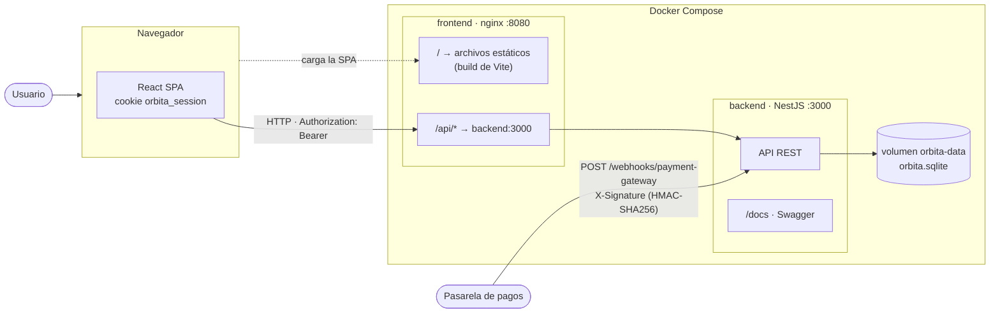
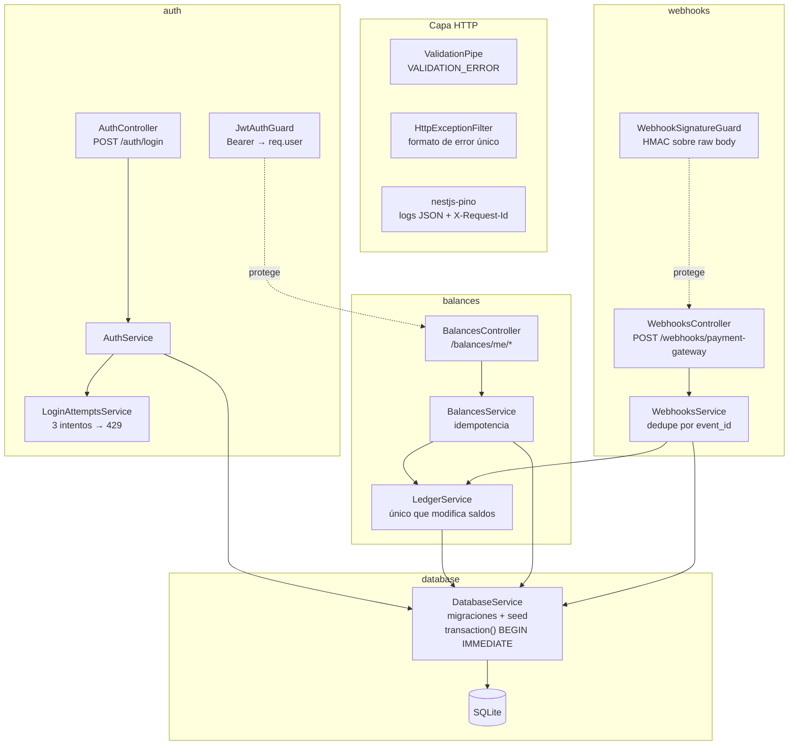
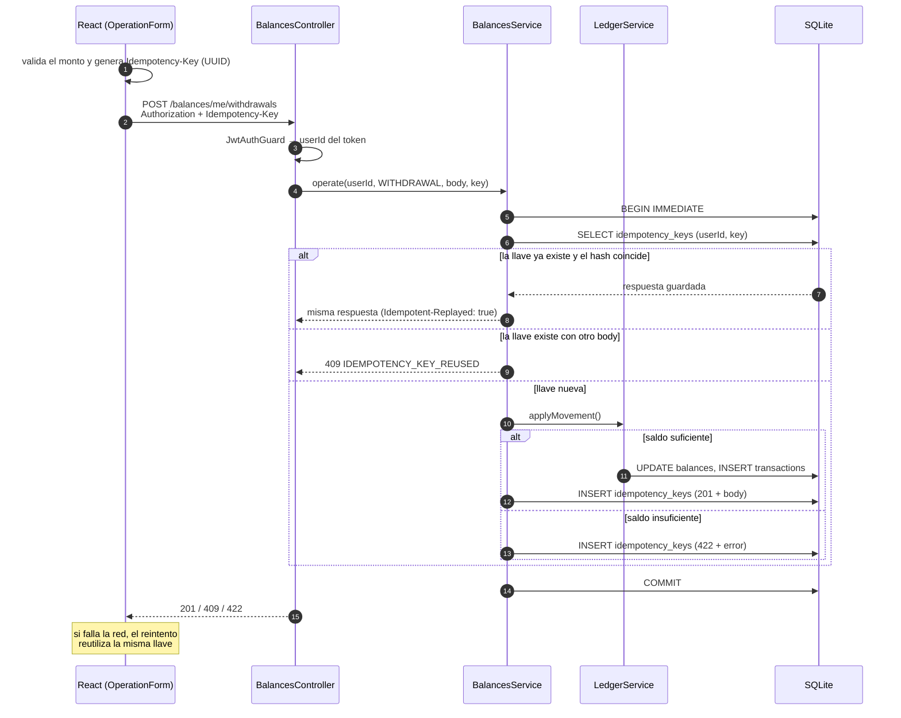
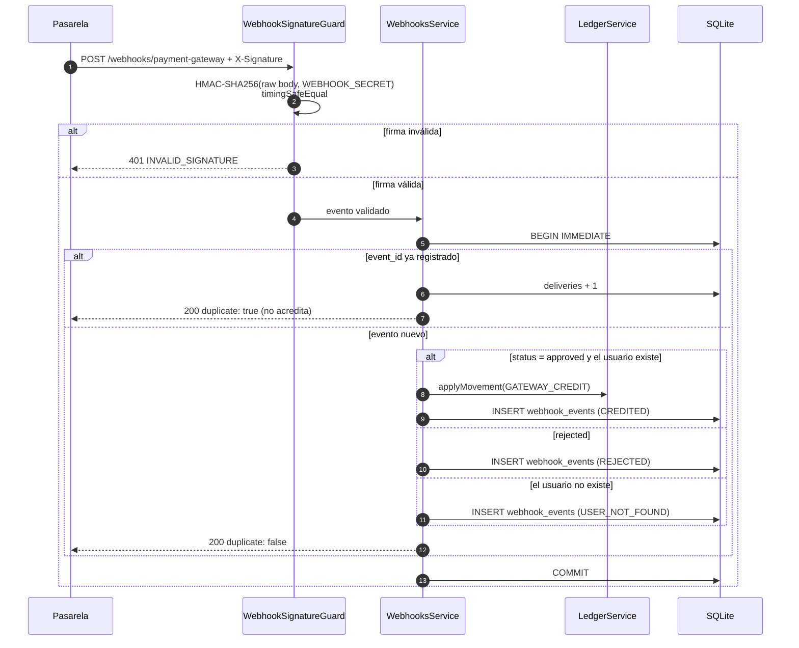
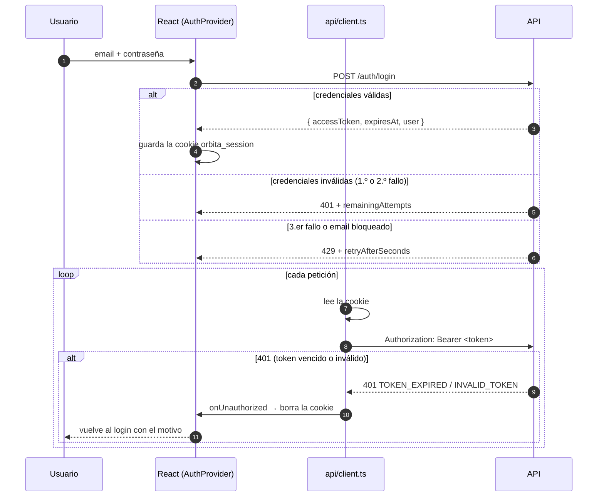
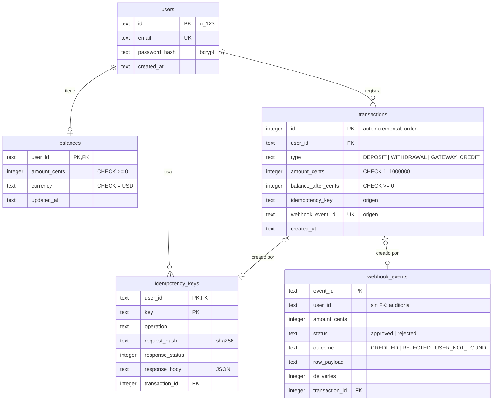
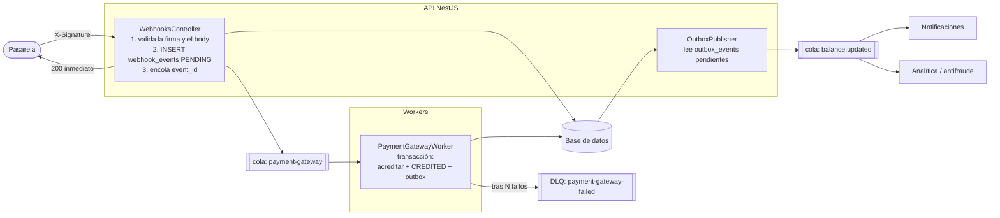
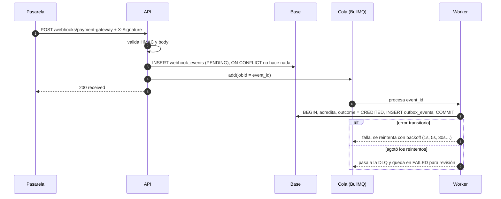

# Arquitectura · Orbita

## 1. Vista general (despliegue con Docker Compose)

- El front y la API comparten origen a través de nginx: no hace falta CORS y la URL de la API no queda embebida en el build. En desarrollo hace lo mismo el proxy de Vite.
- La pasarela llama a la API directamente. No usa token: se autentica con la firma HMAC.

## 2. Módulos del backend

**Regla clave:** todo cambio de saldo pasa por `LedgerService.applyMovement`, siempre dentro de una transacción de `DatabaseService`. Así, el saldo, el movimiento del ledger y el registro de idempotencia o del evento se escriben juntos, o no se escribe nada.

## 3. Flujo: depósito o retiro idempotente

## 4. Flujo: webhook de la pasarela

## 5. Flujo: sesión en el frontend

## 6. Modelo de datos

## 7. Garantías y dónde se aplican

| Garantía | Mecanismo |
|---|---|
| El saldo nunca queda negativo | Validación en `LedgerService` + `CHECK` en `balances` y `transactions` + transacción `BEGIN IMMEDIATE` |
| Un depósito o retiro no se repite | `idempotency_keys` con PK `(user_id, key)`, en la misma transacción que el movimiento |
| Un evento de la pasarela no se acredita dos veces | `webhook_events.event_id` PK + `transactions.webhook_event_id` UNIQUE |
| El webhook solo lo invoca la pasarela | HMAC-SHA256 sobre el raw body, comparado con `timingSafeEqual` |
| El usuario sale siempre del token | `JwtAuthGuard` + `forbidNonWhitelisted` (se rechaza un `user_id` en el body) |
| Login sin enumeración de emails | Mismo error y bcrypt contra un hash de relleno; el límite de intentos también aplica a emails inexistentes |
| Fuerza bruta acotada | 3 intentos fallidos por email → bloqueo de 5 min (429) |
| Trazabilidad | Ledger append-only con `balance_after` y su origen; auditoría de eventos; logs JSON con `X-Request-Id` |

## 8. Evolución propuesta: sistema de colas

> **Estado: propuesta, no implementada.** Hoy todo se resuelve de forma síncrona dentro de una transacción de SQLite, lo que basta para una instancia y garantiza la consistencia. Las colas tienen sentido cuando el sistema crece: más tráfico de la pasarela, varias instancias o servicios que necesitan reaccionar a los movimientos.

### Qué problemas resuelve

| Punto | Hoy | Con colas |
|---|---|---|
| **Webhook** | Valida, acredita y responde en la misma petición | Valida la firma, registra el evento (*inbox*) y responde `200` al instante. Un worker acredita después, así la pasarela no espera ni reintenta por lentitud nuestra |
| **Fallos transitorios** | Un error (p. ej. base ocupada) devuelve 500 y depende de que la pasarela reintente | El worker reintenta con backoff exponencial; tras N intentos el evento pasa a una **dead-letter queue (DLQ)** |
| **`USER_NOT_FOUND`** | Queda registrado y nadie lo vuelve a procesar | Se reprocesa desde la DLQ cuando el usuario exista o tras una revisión manual |
| **Eventos de negocio** | No se emiten | **Outbox transaccional**: el movimiento y el evento `balance.updated` se guardan en la misma transacción, y un publicador los envía a la cola (notificaciones, analítica, antifraude) |

### Diseño

### Flujo del webhook con cola

### Decisiones

- **Herramienta: BullMQ + Redis.**
  - Se integra con NestJS (`@nestjs/bullmq`) y trae reintentos, backoff, DLQ, prioridades y un panel de monitoreo (Bull Board).
  - El mismo Redis serviría para el límite de intentos del login, que hoy vive en memoria.
  - Con un volumen mucho mayor o con varios consumidores independientes usaría **Amazon SQS** o **RabbitMQ**.
- **La idempotencia se mantiene en la base, no en la cola.**
  - Las colas garantizan entrega *al menos una vez*, así que un job puede ejecutarse dos veces.
  - Lo impiden la PK de `webhook_events.event_id` y el `UNIQUE` de `transactions.webhook_event_id`.
  - Usar `jobId = event_id` además evita encolar duplicados.
- **Outbox transaccional en lugar de publicar directo.**
  - Si se publicara en la cola desde dentro de la transacción y luego esta se revirtiera, saldría un evento falso.
  - Con la tabla `outbox_events` el evento existe solo si el movimiento se confirmó.
- **Depósitos y retiros siguen síncronos.**
  - El usuario necesita ver el saldo actualizado en la respuesta, y la `Idempotency-Key` ya cubre los reintentos.
  - Encolarlos obligaría a manejar estados "pendientes" en la pantalla sin un beneficio claro.
- **Base de datos.** Con workers en procesos separados, SQLite deja de ser adecuada (escrituras concurrentes desde varios procesos): este cambio va de la mano con migrar a **PostgreSQL**.

### Cambios necesarios

| Pieza | Cambio |
|---|---|
| `webhook_events` | Nuevos estados `PENDING`, `PROCESSING` y `FAILED`, además de `attempts` y `last_error` |
| `outbox_events` (nueva) | `id`, `type`, `payload`, `created_at`, `published_at` |
| `WebhooksService` | Solo registra y encola; la acreditación pasa a `PaymentGatewayWorker` |
| `OutboxPublisher` | Tarea periódica que publica los eventos pendientes y marca `published_at` |
| Docker Compose | Servicios `redis` y `worker` (misma imagen del backend, con otro comando) |

### Contrapartidas

- **Consistencia eventual:** un pago aprobado puede tardar unos segundos en verse en el saldo. La pantalla tendría que refrescar el saldo (polling o SSE) o mostrar los pagos en proceso.
- **Más infraestructura:** Redis y los workers son piezas nuevas que hay que desplegar, monitorear (tamaño de la cola, DLQ) y mantener.
- **Pruebas más complejas:** se necesitan pruebas de integración con Redis y de los reintentos.
